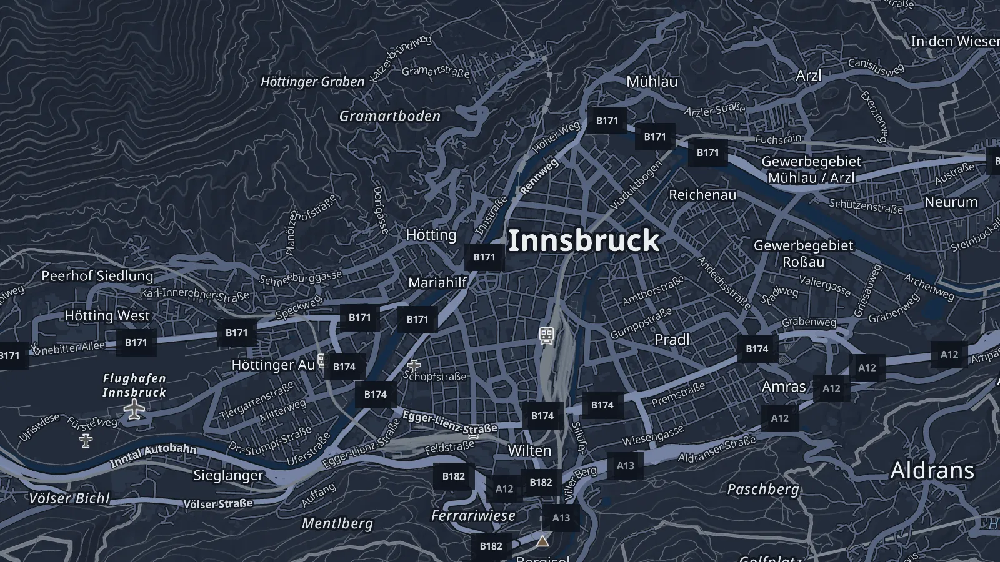

<div class="mx-hero"><div class="mx-hero-text">

<div>

  Österreich · amtliche Daten
  

</div>

<div>

  Die Karte Österreichs, gebaut aus amtlichen Daten.

</div>

<div>

  Grundstücke, Adressen, Routing, Gelände, Orthofoto, öffentlicher Verkehr, Verkehrsmeldungen und Wetter – aus Katastermappe, Laserscan, Verkehrsgraph und Fahrplan der Behörden, als offene Kacheln und APIs für eigene Karten.

</div>

<div class="mx-btns">


</div>
</div>

<div class="mx-hero-img"><p class="mx-hero-cap">Stil <code>streets-night</code>, Innsbruck. Daten: BEV, GIP.at, CC BY 4.0</p></div>
</div>

<p class="mx-note"><strong>Datenquellen:</strong> BEV · GIP.at · ASFINAG · GeoSphere Austria · ÖBB · Umweltbundesamt (GGN) · Statistik Austria · Offene Lizenzen, überwiegend CC BY 4.0</p>

## Was mapx liefert {#produkte}

Je Produkt ein eigener Datensatz mit Stichtag und Quelle. Jedes Produkt hat eine eigene Seite mit Beispiel, Datenquelle und Einschränkungen. Alles, was auf der Karte zu sehen ist, lässt sich auch direkt einbinden.


  
  
  
  
  
  
  
  
  
  


## Einbinden in fünf Minuten. {#entwickler}

*Für Entwickler* – Kacheln sind PMTiles-Dateien mit HTTP-Range-Zugriff, ohne eigenen Kartenserver. Die APIs antworten mit JSON bzw. GeoJSON.

- **MapLibre und PMTiles.** Fertige Kartenstile kommen über die Karten-API (`/v1/styles`).
- **Ein kostenloses Konto genügt.** Anmelden, Token anlegen, loslegen. Herkunft, Stichtag und Attribution stehen je Produkt in der Doku.
- **Maschinenlesbar.** OpenAPI-Beschreibung und `llms.txt` für alle APIs und die Kacheln.

[Zur Entwicklerdoku](https://docs.mapx.at) · [Demo ansehen](https://map.mapx.at)

**Karte mit MapLibre**

```js
import maplibregl from 'maplibre-gl';
import { Protocol } from 'pmtiles';

const TOKEN = 'YOUR_TOKEN'; // öffentlicher Token mx_pk_… vom Konto
maplibregl.addProtocol('pmtiles', new Protocol().tile);

const map = new maplibregl.Map({
  container: 'map',
  style: 'https://api.mapx.at/v1/styles/streets',
  // hängt den Token an jede Anfrage an mapx.at (Style, Tiles, Schriften, Sprites)
  transformRequest: (url) => ({ url: /^https:\/\/([\w-]+\.)?mapx\.at\//.test(url)
    ? url + (url.includes('?') ? '&' : '?') + 'access_token=' + TOKEN : url }),
  center: [15.33, 48.23],
  zoom: 13
});
```

**Höhe abfragen**

```js
// Gipfelhöhe aus dem Geländemodell (DTM, 1 m); Token vom Konto
const r = await fetch(
  'https://api.mapx.at/v1/elevation?points=12.694,47.074',
  { headers: { Authorization: `Bearer ${TOKEN}` } }
);
const { features } = await r.json();
console.log(features[0].properties.elevation);
```

## Kostenlos, mit eigenem Konto. {#zugang}

*API-Zugang* – Die mapx-APIs (Kacheln, Suche, Routing, Höhe, ÖV, Verkehr, Bilder, Wetter) brauchen seit dem 08.11.2026 ein Konto mit API-Token. Das kostet nichts: Registrieren, anmelden, Token anlegen.


  
  
  


### Zwei Arten von Tokens

- **Öffentlicher Token (`mx_pk_…`).** Für Webseiten und Apps. Er darf nur lesen und ist an deine Domains oder an deine Android-App gebunden, so kann ihn niemand sonst verwenden.
- **Geheimer Token (`mx_sk_…`).** Für deinen Server oder Skripte. Nie in eine Webseite oder App einbauen.

Zum Schutz vor Missbrauch gibt es Rate-Limits je Token. Die Nutzung selbst ist kostenlos.

<div class="mx-btns">



</div>

## Eine Quelle, die man benennen kann. {#daten}

*Warum amtliche Daten* – mapx baut Karten ausschließlich aus Daten von Behörden mit klarer offener Lizenz. Jeder Datensatz ist mit Herausgeber, Stichtag und Lizenz dokumentiert.

- **Kataster, Gelände, Orthofoto:** Bundesamt für Eich- und Vermessungswesen (BEV).
- **Straßen, Bahn, Routing:** Graphenintegrations-Plattform GIP.at.
- **Gewässer:** Gesamtgewässernetz des Umweltbundesamts.
- **Fahrplan:** ÖBB-Personenverkehr AG, Datenquelle Mobilitätsverbünde Österreich OG.
- **Verkehrsmeldungen:** ASFINAG / EVIS.AT.
- **Wetter, Klima, Luftqualität:** GeoSphere Austria.
- **Kein OpenStreetMap:** Punkte von Interesse kommen ebenfalls aus amtlichen Quellen.

## Probiere die Karte aus.

Suche eine Adresse, miss eine Strecke oder lass dir ein Höhenprofil zeigen.

<div class="mx-btns">


</div>
