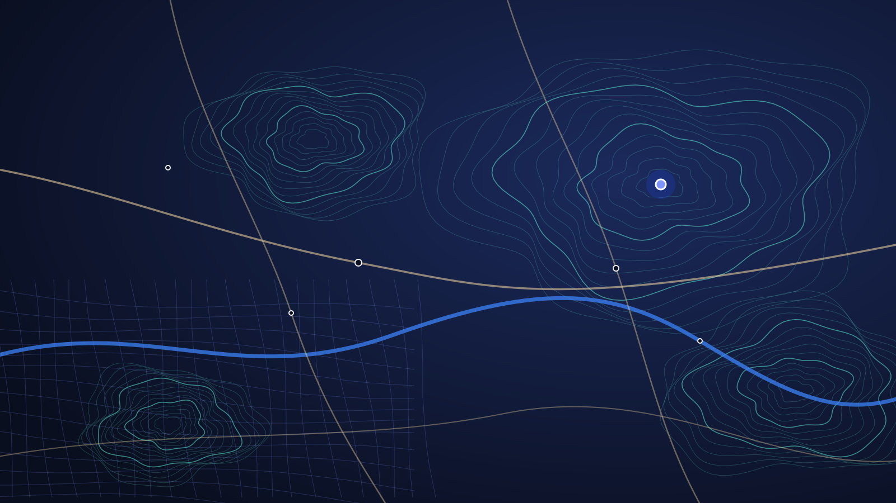

<div class="mx-hero"><div class="mx-hero-text">

<div>

  Österreich · amtliche Daten
  

</div>

<div>

  Die Karte Österreichs, gebaut aus amtlichen Daten.

</div>

<div>

  Grundstücke, Gelände, Höhenlinien, Orthofoto, Adressen und Routing – aus Katastermappe, Laserscan und Verkehrsgraph der Behörden, als offene Kacheln und APIs für eigene Karten.

</div>

<div class="mx-btns">


</div>
</div>

<div class="mx-hero-img"></div>
</div>

<p class="mx-note"><strong>Datenquellen:</strong> BEV · GIP.at · Umweltbundesamt (GGN) · Statistik Austria · Offene Lizenzen, überwiegend CC BY 4.0</p>

## Was mapx liefert {#produkte}

Je Produkt ein eigener Datensatz mit Stichtag und Quelle. Alles, was auf der Karte zu sehen ist, lässt sich auch direkt einbinden.


  
  
  
  
  
  
  
  


## Einbinden in fünf Minuten. {#entwickler}

*Für Entwickler* – Kacheln sind PMTiles-Dateien mit HTTP-Range-Zugriff, ohne eigenen Kartenserver. Die Höhen-API antwortet mit GeoJSON.

- **MapLibre und PMTiles.** Der Stil der Demo-Karte ist öffentlich und lässt sich direkt laden.
- **Ein kostenloses Konto genügt.** Anmelden, Token anlegen, loslegen. Herkunft, Stichtag und Attribution stehen je Produkt in der Doku.
- **Maschinenlesbar.** OpenAPI-Beschreibung und `llms.txt` für die Höhen-API und die Kacheln.

[Zur Entwicklerdoku](https://docs.mapx.at) · [Demo ansehen](https://map.mapx.at)

**Karte mit MapLibre**

```js
import maplibregl from 'maplibre-gl';
import { Protocol } from 'pmtiles';

maplibregl.addProtocol('pmtiles', new Protocol().tile);

const map = new maplibregl.Map({
  container: 'map',
  style: 'https://mapx.at/style.json',
  center: [15.33, 48.23],
  zoom: 13,
  transformRequest: (url) => url.includes('mapx.at')
    ? { url, headers: { Authorization: `Bearer ${TOKEN}` } }
    : undefined
});
```

**Höhe abfragen**

```js
// Gipfelhöhe aus dem Geländemodell (DTM, 1 m); Token vom Konto
const r = await fetch(
  'https://api.mapx.at/v1/elevation?points=12.694,47.074',
  { headers: { Authorization: `Bearer ${TOKEN}` } }
);
const { features } = await r.json();
console.log(features[0].properties.elevation);
```

## Kostenlos, mit eigenem Konto. {#zugang}

*API-Zugang* – Die mapx-APIs (Kacheln, Suche, Routing, Höhe) brauchen seit dem 08.11.2026 ein Konto mit API-Token. Das kostet nichts: Registrieren, anmelden, Token anlegen.


  
  
  


### Zwei Arten von Tokens

- **Öffentlicher Token (`mx_pk_…`).** Für Webseiten und Apps. Er darf nur lesen und ist an deine Domains oder an deine Android-App gebunden, so kann ihn niemand sonst verwenden.
- **Geheimer Token (`mx_sk_…`).** Für deinen Server oder Skripte. Nie in eine Webseite oder App einbauen.

Zum Schutz vor Missbrauch gibt es Rate-Limits je Token. Die Nutzung selbst ist kostenlos.

<div class="mx-btns">



</div>

## Eine Quelle, die man benennen kann. {#daten}

*Warum amtliche Daten* – mapx baut Karten ausschließlich aus Daten von Behörden mit klarer offener Lizenz. Jeder Datensatz ist mit Herausgeber, Stichtag und Lizenz dokumentiert.

- **Kataster, Gelände, Orthofoto:** Bundesamt für Eich- und Vermessungswesen (BEV).
- **Straßen, Bahn, Routing:** Graphenintegrations-Plattform GIP.at.
- **Gewässer:** Gesamtgewässernetz des Umweltbundesamts.
- **Kein OpenStreetMap:** Punkte von Interesse kommen ebenfalls aus amtlichen Quellen.

[Mehr im Blog](https://blog.mapx.at)

## Probiere die Karte aus.

Suche eine Adresse, miss eine Strecke oder lass dir ein Höhenprofil zeigen.

<div class="mx-btns">


</div>
