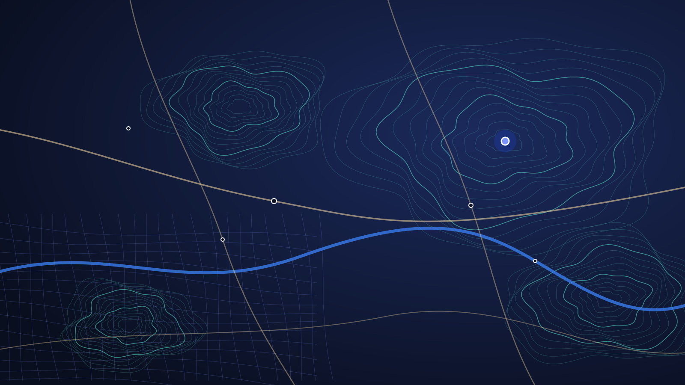



  Austria · official data
  


<div class="hx-mt-6 hx-mb-6">

  The map of Austria, built from official data.

</div>

<div class="hx-mb-12">

  Parcels, terrain, contours, orthophoto, addresses and routing – from the cadastral map, laser scan and traffic graph of the authorities, as open tiles and APIs for your own maps.

</div>

<div class="hx-mb-6 hx-flex hx-flex-wrap hx-gap-3">


</div>



<p class="hx-text-sm hx-text-gray-500 dark:hx-text-gray-400 hx-mt-4 hx-mb-0"><strong>Data sources:</strong> BEV · GIP.at · Umweltbundesamt (GGN) · Statistik Austria · Open licences, mostly CC BY 4.0</p>

## What mapx delivers {#produkte}

Each product is its own dataset with a reference date and source. Everything you see on the map can also be embedded directly.


  
  
  
  
  
  
  
  


## Embed it in five minutes. {#entwickler}

*For developers* – Tiles are PMTiles files with HTTP range access, no map server of your own needed. The elevation API answers with GeoJSON.

- **MapLibre and PMTiles.** The style of the demo map is public and can be loaded directly.
- **A free account is all you need.** Sign in, create a token, get going. Origin, reference date and attribution are listed per product in the docs.
- **Machine-readable.** OpenAPI description and `llms.txt` for the elevation API and the tiles.

[Go to the developer docs](https://docs.mapx.at) · [See the demo](https://map.mapx.at)

**Map with MapLibre**

```js
import maplibregl from 'maplibre-gl';
import { Protocol } from 'pmtiles';

maplibregl.addProtocol('pmtiles', new Protocol().tile);

const map = new maplibregl.Map({
  container: 'map',
  style: 'https://mapx.at/style.json',
  center: [15.33, 48.23],
  zoom: 13,
  transformRequest: (url) => url.includes('mapx.at')
    ? { url, headers: { Authorization: `Bearer ${TOKEN}` } }
    : undefined
});
```

**Query elevation**

```js
// Summit elevation from the terrain model (DTM, 1 m); token from your account
const r = await fetch(
  'https://api.mapx.at/v1/elevation?points=12.694,47.074',
  { headers: { Authorization: `Bearer ${TOKEN}` } }
);
const { features } = await r.json();
console.log(features[0].properties.elevation);
```

## Free, with your own account. {#zugang}

*API access* – The mapx APIs (tiles, search, routing, elevation) require an account with an API token as of 8 November 2026. It costs nothing: sign up, sign in, create a token.


  
  
  


### Two kinds of tokens

- **Public token (`mx_pk_…`).** For websites and apps. It is read-only and bound to your domains or your Android app, so nobody else can use it.
- **Secret token (`mx_sk_…`).** For your server or scripts. Never put it in a web page or an app.

To protect against abuse there are rate limits per token. Usage itself is free of charge.

<div class="hx-mb-6 hx-flex hx-flex-wrap hx-gap-3">



</div>

## A source you can name. {#daten}

*Why official data* – mapx builds maps exclusively from data of public authorities under a clear open licence. Every dataset is documented with publisher, reference date and licence.

- **Cadastre, terrain, orthophoto:** Federal Office of Metrology and Surveying (BEV).
- **Roads, rail, routing:** Graph Integration Platform GIP.at.
- **Water:** national water network of the Umweltbundesamt.
- **No OpenStreetMap:** points of interest also come from official sources.

[More on the blog](https://blog.mapx.at)



## Try the map.

Search an address, measure a distance or show an elevation profile.

<div class="hx-mb-6 hx-flex hx-flex-wrap hx-gap-3">


</div>
