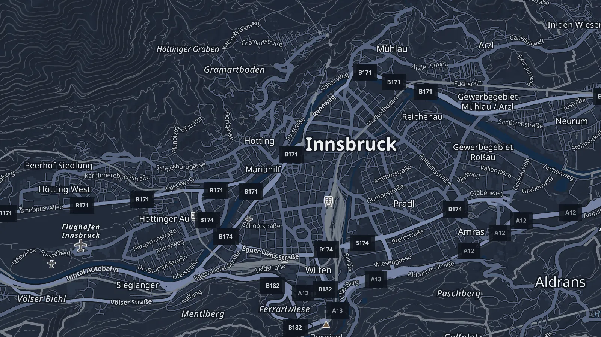

<div class="mx-hero"><div class="mx-hero-text">

<div>

  Austria · official data
  

</div>

<div>

  The map of Austria, built from official data.

</div>

<div>

  Addresses, routing, terrain, orthophoto, public transport, traffic reports and weather – from the cadastral map, laser scan, road graph and timetable of the authorities, as open tiles and APIs for your own maps.

</div>

<div class="mx-btns">


</div>
</div>

<div class="mx-hero-img"><p class="mx-hero-cap">Style <code>streets-night</code>, Innsbruck. Data: BEV, GIP.at, CC BY 4.0</p></div>
</div>

<p class="mx-note"><strong>Data sources:</strong> BEV · GIP.at · ASFINAG · GeoSphere Austria · ÖBB · Umweltbundesamt (GGN) · Statistik Austria · Open licences, mostly CC BY 4.0</p>

## What mapx delivers {#produkte}

Each product is its own dataset with a reference date and source. Each product has its own page with an example, the data source and limitations. Everything you see on the map can also be embedded directly.


  
  
  
  
  
  
  
  
  


All ready-made map styles with preview and live map: [map style gallery](/en/gallery/) →

## Embed it in five minutes. {#entwickler}

*For developers* – Tiles are PMTiles files with HTTP range access, no map server of your own needed. The APIs answer with JSON or GeoJSON.

- **MapLibre and PMTiles.** Ready-made map styles come from the maps API (`/v1/styles`).
- **A free account is all you need.** Sign in, create a token, get going. Origin, reference date and attribution are listed per product in the docs.
- **Machine-readable.** OpenAPI description and `llms.txt` for all APIs and the tiles.

[Go to the developer docs](https://docs.mapx.at) · [See the demo](https://map.mapx.at)

**Map with MapLibre**

```js
import maplibregl from 'maplibre-gl';
import { Protocol } from 'pmtiles';

const TOKEN = 'YOUR_TOKEN'; // public token mx_pk_… from your account
maplibregl.addProtocol('pmtiles', new Protocol().tile);

const map = new maplibregl.Map({
  container: 'map',
  style: 'https://api.mapx.at/v1/styles/streets',
  // appends the token to every request to mapx.at (style, tiles, fonts, sprites)
  transformRequest: (url) => ({ url: /^https:\/\/([\w-]+\.)?mapx\.at\//.test(url)
    ? url + (url.includes('?') ? '&' : '?') + 'access_token=' + TOKEN : url }),
  center: [15.33, 48.23],
  zoom: 13
});
```

**Query elevation**

```js
// Summit elevation from the terrain model (DTM, 1 m); token from your account
const r = await fetch(
  'https://api.mapx.at/v1/elevation?points=12.694,47.074',
  { headers: { Authorization: `Bearer ${TOKEN}` } }
);
const { features } = await r.json();
console.log(features[0].properties.elevation);
```

## Free, with your own account. {#zugang}

*API access* – The mapx APIs (tiles, search, routing, elevation, transit, traffic, images, weather) require an account with an API token as of 8 November 2026. It costs nothing: sign in, create a token, get going.


  
  
  


### Two kinds of tokens

- **Public token (`mx_pk_…`).** For websites and apps. It is read-only and bound to your domains or your Android app, so nobody else can use it.
- **Secret token (`mx_sk_…`).** For your server or scripts. Never put it in a web page or an app.

To protect against abuse there are rate limits per token. Usage itself is free of charge.

<div class="mx-btns">


</div>

## A source you can name. {#daten}

*Why official data* – mapx builds maps exclusively from data of public authorities under a clear open licence. Every dataset is documented with publisher, reference date and licence.

- **Addresses, cadastral map (buildings, land use), terrain, orthophoto:** Federal Office of Metrology and Surveying (BEV).
- **Roads, rail, routing:** Graph Integration Platform GIP.at.
- **Water:** national water network of the Umweltbundesamt.
- **Timetable:** ÖBB-Personenverkehr AG, data source Mobilitätsverbünde Österreich OG.
- **Traffic reports:** ASFINAG / EVIS.AT.
- **Weather, climate, air quality:** GeoSphere Austria.
- **No OpenStreetMap:** points of interest also come from official sources.

## Try the map.

Search an address, measure a distance or show an elevation profile.

<div class="mx-btns">


</div>
